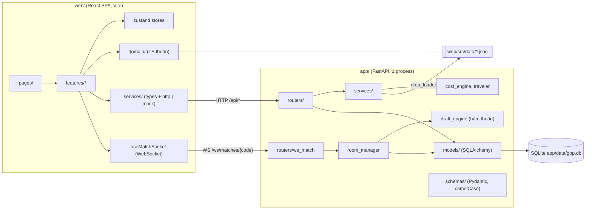

# ARCHITECTURE

Mô tả kiến trúc **hiện tại**. Số liệu chi tiết, rủi ro và bằng chứng: `../docs/PROJECT_ANALYSIS.md`. Quyết định đã chốt: `DECISION_LOG.md`.

## 1. Tổng quan



- Hai ứng dụng độc lập trong một repo: **không** có package dùng chung, **không** monorepo tool. Hợp đồng giữa chúng là JSON camelCase.
- Dev: Vite (5173) proxy `/api`, `/ws` → uvicorn (8000). Production: chưa định nghĩa (ADR-009).

## 2. Backend (`app/`)

Phân lớp: **router (mỏng) → service (nghiệp vụ) → model (ORM)**; `schemas` là hợp đồng I/O.

| Thành phần | Vai trò | Lưu ý |
|---|---|---|
| `main.py` | `create_app(db_engine, session_factory)`; lifespan; CORS; handler lỗi; seed admin + ruleset mặc định | Tests tiêm engine tạm — giữ chữ ký này |
| `core/config.py` | `Settings` (pydantic-settings, `app/.env`), `ROOT_DIR/APP_DIR/DATA_DIR/WEB_DATA_DIR` | `get_settings()` có `lru_cache` |
| `core/database.py` | `Base`, `create_engine_and_session`, `get_db` | async SQLAlchemy |
| `core/deps.py` | `get_optional_user`, `get_current_user`, `require_admin`, `require_super_admin_or_secret` | Role đọc từ DB |
| `core/errors.py` | `AppError` + helper `unauthorized/forbidden/bad_request/not_found/conflict` | Dùng helper này, không tự `HTTPException` |
| `core/security.py` | PBKDF2 hash, JWT encode/decode | |
| `models/` | `User`, `UserCharacter`, `RuleSet`, `Match` | Match giữ `state_json` + `ruleset_snapshot` |
| `schemas/` | `CamelModel` (alias camelCase, `populate_by_name`) | Thêm field = đổi hợp đồng với `web/src/services/types.ts` |
| `services/draft_engine.py` | **Toàn bộ luật trận**, hàm thuần `MatchState → MatchState` | 1521 dòng — vùng nhạy cảm |
| `services/room_manager.py` | Singleton `room_manager`: kết nối WS, khóa theo phòng, timer, lưu DB, broadcast | Trạng thái in-memory, 1 process |
| `services/cost_engine.py` | Cost, giây tinh luyện, phạt theo milestone, điểm 3 ải | |
| `services/traveler.py` | Chuẩn hóa slug/kho Traveler, migration cost cũ | |
| `data_loader.py` | Đọc `web/src/data/*.json` | Coupling backend → thư mục web |

### Luồng một action WebSocket

```mermaid
sequenceDiagram
  participant C as Client
  participant W as ws_match
  participant RM as room_manager.handle_action
  participant DE as draft_engine
  participant DB as matches.state_json
  C->>W: {"action": "draft_pick_or_ban", ...}
  W->>W: xác thực user (token query/cookie), khách bị chặn
  W->>RM: handle_action(code, user, payload)
  RM->>RM: lock theo phòng; load Match + MatchState
  RM->>DE: hàm thuần theo action
  DE-->>RM: MatchState mới (hoặc AppError)
  RM->>DB: lưu state_json, status, người chơi, winner
  RM->>RM: đồng bộ timer
  RM-->>C: broadcast {"type":"match:state","state":...,"notice":?} tới cả phòng
```

- Lỗi nghiệp vụ → `AppError` → gửi lại **chỉ người gửi** `{"type":"match:error","code","message"}`.
- Client nhận `match:state` luôn là **toàn bộ state** (không phải diff).

### State machine trận

`lobby → drafting → weapon_phase → scoring → between_games (BO3) → finished`. `drafting` có timer lượt/forfeit; `weapon_phase` có timeout riêng. Timer được hẹn trong `room_manager._sync_phase_timer`, và cũng được "bắt kịp" khi `get_state` thấy deadline đã qua (phòng trường hợp server khởi động lại).

### Danh mục action WS

`select_side`, `refresh_inventory`, `set_ready`, `choose_next_side`, `draft_hover`, `draft_pick_or_ban`, `undo_draft_step`, `request_undo`, `respond_undo`, `cancel_undo_request`, `set_weapon`, `set_character_custom_cost`, `reorder_lineup`, `lock_weapons`, `submit_scores`, `ping`. Thêm/đổi action = đổi giao thức (Tier 2) → cập nhật cả `room_manager`, `useMatchSocket`/UI, test WS, và mục này.

## 3. Frontend (`web/src/`)

| Lớp | Thư mục | Quy tắc phụ thuộc |
|---|---|---|
| Trang | `pages/` | ghép feature; không chứa logic nghiệp vụ lớn |
| Tính năng | `features/{auth,inventory,match,rules}` | UI + store + logic riêng của tính năng |
| UI nền | `components/ui`, `components/layout` | không import từ `features/` |
| Domain | `domain/` | **TS thuần**: không import React/DOM/`services` |
| Services | `services/` | `types.ts` (interface + DTO) → `http/*` hoặc `mock/*`; chỉ `services/` gọi `fetch` |
| Hạ tầng | `lib/` (`cn`, `storage`), `config/brand.ts` | |

- **Routing:** `router.tsx` — `/login`, `/register`; trong `AppShell`: `/`, `/rules`, `/lobby`, `/match/:code`, `/admin/users`, `/profile` (ProtectedRoute), `*`.
- **Auth:** `authStore` (zustand) gọi `authService`. Token: `localStorage`/`sessionStorage` + cookie httpOnly; request gửi Bearer + `credentials: 'include'`.
- **Match:** `useMatchSocket(code)` tải state qua REST rồi mở WS, tự reconnect (1,5s), ping 25s; `sendAction(payload)` gửi `{action,...}`. `useCountdownSeconds(deadlineIso)` đếm ngược từ `turnDeadlineAt`.
- **Mock:** `VITE_API_MODE=mock` → chỉ `auth` + `inventory` dùng localStorage. Các service còn lại luôn HTTP.
- **Alias:** `@/` → `web/src/`.

## 4. Hợp đồng frontend ↔ backend

| Phía FE | Phía BE | Ghi chú |
|---|---|---|
| `services/types.ts` (`MatchState`, `SideState`, …) | `schemas/match.py` | camelCase qua `CamelModel`. **Đổi một bên phải đổi bên kia** |
| `domain/ruleset.ts` (`RuleSetConfig`) | `schemas/ruleset.py` | BE có validator migrate dữ liệu cũ — giữ tương thích |
| `domain/inventory.ts` | `schemas/inventory.py` | level ∈ {90,95,100}, C ∈ 0..6 (cả CHECK constraint DB) |
| `services/http/*` | `routers/*` | `ServiceError(code,message)` ← body `{code,message}` |
| WS message `match:state / match:error / pong` | `ws_match.py`, `room_manager` | |

## 5. Dữ liệu & lưu trữ

| Bảng | Khóa/Ràng buộc | Ghi chú |
|---|---|---|
| `users` | `id` UUID, `uid` unique, `email` unique nullable | `role` ∈ player/admin |
| `user_characters` | PK `(user_id, character_slug)`; CHECK C 0..6, level ∈ 90/95/100 | `PUT inventory` xóa-rồi-chèn |
| `rulesets` | `id` UUID | `config_json`; luôn còn ≥1 bộ; đúng 1 default (xử lý trong router) |
| `matches` | `id` UUID, `code` unique | `state_json` (toàn bộ `MatchState`), `ruleset_snapshot`, `host/blue/red_user_id` (không FK) |

- Bảng tạo bằng `create_all`; **không migration**. Đổi cột = DB cũ không tự cập nhật (ADR-004, Open-01).
- Thay đổi shape của `state_json`/`config_json` phải **đọc được dữ liệu cũ** (Pydantic default / `model_validator(mode="before")`).

## 6. Bất biến cần giữ (đừng phá)

1. Kết quả trận **do server tính** từ snapshot luật + kho đã chụp; không tin điểm từ client.
2. `MatchState` bất biến theo kiểu "copy rồi sửa" (`model_copy(deep=True)`); mọi thay đổi trạng thái đi qua `draft_engine` rồi `room_manager` lưu + broadcast, dưới **lock theo phòng**.
3. Luật của trận lấy từ `ruleset_snapshot` lúc tạo; sửa/xóa RuleSet sau đó **không** ảnh hưởng trận đang diễn ra.
4. Cung mệnh/level của người chơi được lấy từ kho (và chụp vào `ownedCharacters`), không nhập tay trong trận.
5. Traveler: kho dùng slug giới tính; trong trận dùng slug nguyên tố; luôn qua `traveler.py`.
6. `AppError.message` hiển thị trực tiếp cho người dùng → phải là tiếng Việt, không lộ chi tiết nội bộ.
7. `web/src/data/*.json` được **cả backend đọc** — đổi tên/đường dẫn/format phải sửa `config.py`, `data_loader.py`, test.
8. `create_app(db_engine=..., session_factory=...)` và `room_manager.bind_session_factory` là điểm tiêm của test — không đổi chữ ký tùy tiện.

## 7. Vùng nhạy cảm (Tier 2 mặc định — cần kế hoạch + chấp thuận)

| Vùng | Lý do |
|---|---|
| `app/services/draft_engine.py`, `room_manager.py` | Toàn bộ luật & đồng bộ realtime; nhiều ca biên (timer, undo, BO3, Traveler) |
| `app/services/cost_engine.py` ↔ `web/src/domain/cost.ts` | Công thức trùng 2 nơi, ảnh hưởng điểm thắng/thua |
| `app/schemas/*` ↔ `web/src/services/types.ts` | Hợp đồng FE/BE |
| `app/models/*`, `create_all`, `state_json`/`config_json` | Không có migration |
| `app/core/security.py`, `deps.py`, cookie/JWT, `ws_match` auth | Bảo mật |
| `app/core/config.py` (mặc định), `.env.example` | Ảnh hưởng triển khai |
| `web/src/data/*.json`, `assets/dataminer*.py` | Dữ liệu sinh tự động, backend phụ thuộc |
| `web/src/features/match/*` (file >500 dòng) | UI phức tạp, có test snapshot-like theo hành vi |

## 8. Hạn chế đã biết (không phải việc cần "sửa tiện thể")

Một tiến trình; không migration; không CI; token WS ở query string; không rate-limit; JWT không thu hồi. Danh sách đầy đủ: `../docs/PROJECT_ANALYSIS.md` §13. Chỉ xử lý khi có task riêng được duyệt.

_Cập nhật lần cuối: 2026-11-28 (thiết lập ban đầu)._
