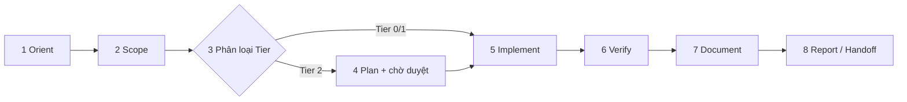

# DEVELOPMENT_WORKFLOW

Quy trình thống nhất cho **mọi** AI Agent và developer. Mục tiêu: thay đổi có kế hoạch, phạm vi rõ, ít lỗi, tài liệu đồng bộ.

## 1. Orient (bắt buộc, ~5 phút)

1. Đọc `.ai/README.md` → `PROJECT_CONTEXT.md` → (nếu sửa code) `ARCHITECTURE.md`, `CODING_STANDARDS.md`.
2. `git status --short` và `git log --oneline -5`: biết cây làm việc có thay đổi dở của người khác không. **Không đụng** vào thay đổi không thuộc task.
3. Kiểm tra `.ai/tasks/` (nếu có): có task dở của phiên trước cần tiếp tục không.
4. Mở **trực tiếp** các file sẽ sửa và file lân cận/test liên quan. Dùng `grep` tìm nơi sử dụng trước khi đổi chữ ký/tên.

## 2. Scope

Viết ra (trong phản hồi hoặc `TASK_TEMPLATE.md`): **mục tiêu**, **ngoài phạm vi**, **file dự kiến chạm**, **tiêu chí hoàn thành**, **cách kiểm chứng**. Yêu cầu mơ hồ ảnh hưởng hành vi/dữ liệu → **hỏi lại** thay vì đoán.

## 3. Phân loại thay đổi

| Tier | Là gì | Quy trình |
|---|---|---|
| **0 – Nhỏ** | Sửa chính tả/copy, comment, tài liệu, style không đổi hành vi | Làm luôn → Verify nhẹ → Report |
| **1 – Chuẩn** | Sửa lỗi hoặc thêm tính năng **theo pattern có sẵn**, không đổi hợp đồng/schema/giao thức, ~≤ 6 file | Nêu kế hoạch ngắn (3–6 dòng) → làm → Verify → Report |
| **2 – Kiến trúc / rủi ro** | Bất kỳ mục nào bên dưới | **Dừng. Viết kế hoạch, chờ developer chấp thuận rõ ràng**, rồi mới sửa code. Ghi ADR vào `DECISION_LOG.md` |

**Tier 2 nếu thay đổi chạm:**
- Thêm/xóa/nâng cấp **dependency**, framework, build tool, cấu hình `tsconfig/eslint/vite`.
- **Schema DB** (bảng/cột/ràng buộc), hoặc shape `state_json` / `config_json` (không có migration).
- **API/WS contract**: endpoint, action WS, field `schemas/*.py` ↔ `services/types.ts`.
- **Auth/phân quyền/bảo mật**: JWT, cookie, role, CORS, secret, `ws_match` auth.
- **Luật chơi & điểm**: `draft_engine.py`, `cost_engine.py` ↔ `domain/cost.ts`, tie-break, timer, undo.
- Cấu trúc thư mục, di chuyển/đổi tên module, tách/gộp file lớn, `web/src/data/*.json` (backend phụ thuộc).
- Triển khai/CI/Docker/biến môi trường mặc định.
- **Xóa** hoặc vô hiệu hóa bất kỳ tính năng/route/endpoint/action nào.
- Tính năng cộng đồng mới (hồ sơ công khai, thống kê, giải đấu…) cần bảng/API mới.

Không chắc → coi là Tier 2.

### Khi phải DỪNG và hỏi
- Task mâu thuẫn với `.ai/` hoặc yêu cầu "bảo toàn tính năng hiện có".
- Cần quyết định chưa có trong `DECISION_LOG.md`.
- Test hiện có fail **trước** khi bạn sửa (báo lại, không tự "sửa cho xanh").
- Phát hiện lỗi/rủi ro ngoài phạm vi: **ghi nhận trong báo cáo**, không tự sửa.

## 4. Plan (Tier 2)

Nội dung tối thiểu: bối cảnh & vấn đề · phương án (≥2 nếu có lựa chọn kiến trúc) và đề xuất · file/vùng ảnh hưởng · tác động tới dữ liệu đã lưu & hợp đồng FE/BE · kế hoạch test · kế hoạch rollback · câu hỏi mở. Dùng `TASK_TEMPLATE.md`. **Chờ phản hồi chấp thuận** trước khi viết code.

## 5. Implement

- Làm theo từng bước nhỏ, mỗi bước có thể kiểm chứng. Ưu tiên sửa tại chỗ hơn tạo module mới.
- Bắt chước pattern lân cận (xem `CODING_STANDARDS.md`). Không refactor ngoài phạm vi.
- Đổi hợp đồng: sửa **cả hai phía** trong cùng thay đổi, giữ tương thích dữ liệu cũ.
- Dữ liệu/ cấu hình nhạy cảm: không in secret, không commit `.env`/`.db`.

## 6. Verify

Chạy lệnh tương ứng vùng đã sửa (bảng ở `CODING_STANDARDS.md` §5). Quy tắc:
- Lệnh đầy đủ: backend `.\app\.venv\Scripts\python.exe -m pytest app/tests -q`; frontend (trong `web/`) `pnpm test -- --run`, `pnpm typecheck`, `pnpm lint`; thay đổi build: `pnpm build`.
- Baseline xanh ngày 2026-11-28: pytest 33, vitest 68, tsc, eslint. Nếu kết quả khác baseline do **không phải do bạn**, nói rõ.
- Không báo "xong" khi chưa chạy kiểm chứng; nếu không chạy được, nói rõ lý do và việc còn lại.
- Thay đổi UI: kiểm tra thủ công trong trình duyệt (golden path + một ca lỗi) khi có thể, và nêu rõ nếu chưa làm.

## 7. Document — ma trận đồng bộ tài liệu

| Nếu bạn thay đổi… | Cập nhật |
|---|---|
| Thêm/bỏ tính năng, đổi hành vi người dùng | `README.md` (mô tả/tính năng), `.ai/PROJECT_CONTEXT.md` (bảng trạng thái) |
| Endpoint, action WS, schema, model, cấu trúc thư mục, luồng trận | `.ai/ARCHITECTURE.md` (+ `docs/PROJECT_ANALYSIS.md` §4/§6 nếu số liệu đổi) |
| Quy ước code/test/công cụ | `.ai/CODING_STANDARDS.md` |
| Quy trình làm việc, lệnh chạy, baseline test | `.ai/DEVELOPMENT_WORKFLOW.md`, `.ai/README.md`, `README.md` |
| Biến môi trường mới | `app/.env.example` + `.ai/ARCHITECTURE.md` + `README.md` |
| Quyết định kiến trúc/ lựa chọn công nghệ | `.ai/DECISION_LOG.md` (ADR mới) |
| Dữ liệu game (`characters.json`, `weapons.json`) | `README.md` nếu đổi quy trình dataminer; cập nhật số lượng ở `PROJECT_CONTEXT.md` §6 |
| Rủi ro/nợ kỹ thuật mới phát hiện hoặc đã giải quyết | `docs/PROJECT_ANALYSIS.md` §13 |

Ghi ngày vào dòng "Cập nhật lần cuối" của mỗi file đã sửa. Không sao chép số liệu có thể lỗi thời (số test, số dòng) vào nhiều nơi — ưu tiên một nơi và trỏ tới.

## 8. Report / Handoff

Kết thúc mỗi phiên, báo cáo ngắn gồm:

1. **Đã làm** (file chính, hành vi thay đổi) và **không làm** (ngoài phạm vi).
2. **Kết quả kiểm chứng** (lệnh + kết quả thật).
3. **Tài liệu đã cập nhật** (hoặc "không cần" + lý do).
4. **Rủi ro / việc dang dở / câu hỏi cho developer**.
5. Nếu task kéo dài nhiều phiên: lưu trạng thái vào `.ai/tasks/YYYY-MM-DD-<slug>.md` (theo `TASK_TEMPLATE.md`): đã xong, đang làm, bước kế tiếp, quyết định đã chốt, lệnh để tiếp tục. Xóa/đánh dấu hoàn thành khi xong.

## 9. Làm việc với nhiều Agent / nhiều phiên

- Mọi agent đọc cùng bộ `.ai/`; `AGENTS.md` ở gốc là điểm vào cho công cụ tự đọc.
- **Một cây làm việc, một người ghi:** không chỉnh sửa song song cùng file. Nếu chia việc, giao theo thư mục rõ ràng (`app/` vs `web/`) và thống nhất trước về hợp đồng.
- Agent mới **không tin** bộ nhớ phiên trước: tin `.ai/`, `git log`, và code. Nếu phát hiện `.ai/` sai → sửa tài liệu (Tier 0) và nêu trong báo cáo.
- Không ghi đè/hoàn tác công việc của agent/người khác chưa commit; nếu xung đột, dừng và báo.
- Quyết định lớn luôn đi qua `DECISION_LOG.md` để agent sau thấy.

## 10. Quy tắc git

Xem `CODING_STANDARDS.md` §7. Mặc định: **không commit, không push, không tạo nhánh** nếu developer chưa yêu cầu. Khi được yêu cầu commit: Conventional Commits, chỉ add file thuộc task (không `git add .` mù quáng).

## 11. Mở rộng hệ thống `.ai/`

Khi dự án lớn hơn, có thể thêm (qua Tier 2 + ADR): `.ai/tasks/` (nhật ký task), `.ai/FEATURES/<tên>.md` (spec từng tính năng), `.ai/RUNBOOK.md` (vận hành/deploy khi đã có), `.ai/PROMPTS/` (mẫu prompt cho review/test). Mỗi file thêm vào phải được liệt kê trong `.ai/README.md`.

_Cập nhật lần cuối: 2026-11-28 (thiết lập ban đầu)._
