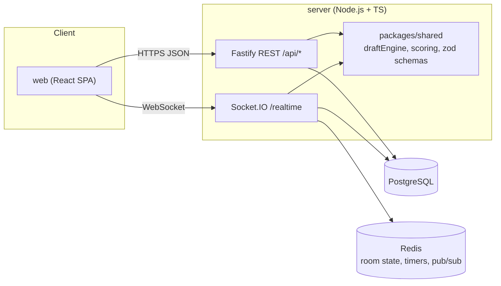
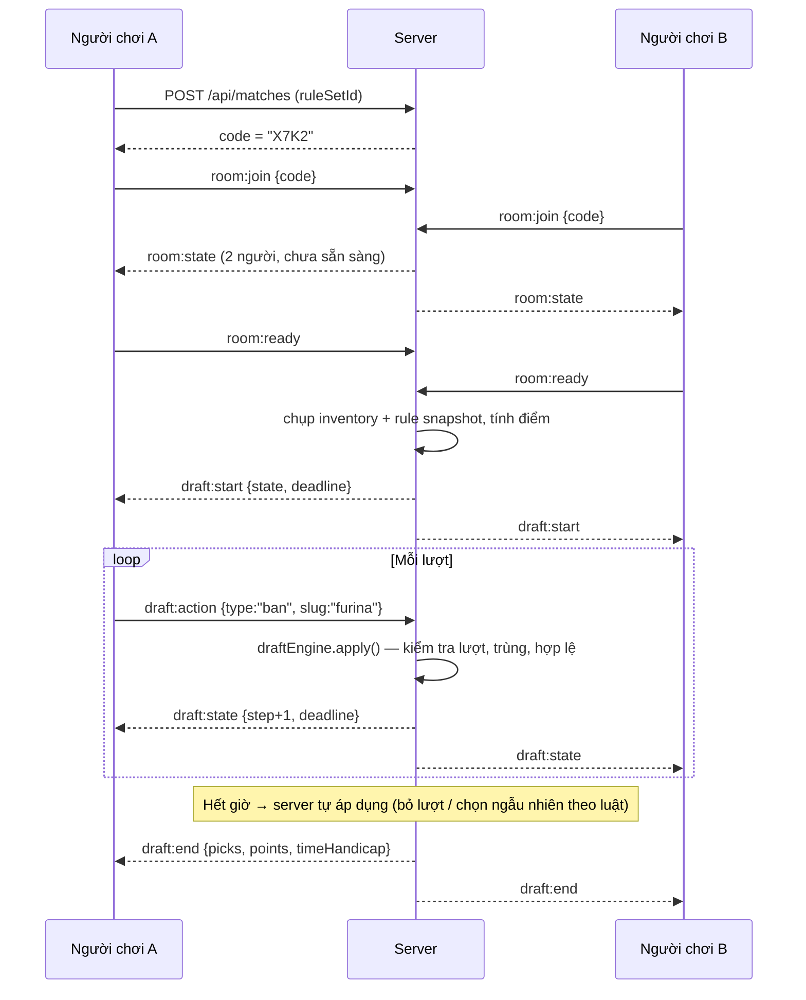

# Kế hoạch Backend — Genshin Ban/Pick VN (để duyệt sau)

> [!NOTE]
> Tài liệu này **chưa triển khai**. Mục đích: chốt hướng kỹ thuật để frontend (GĐ1–3) được thiết kế tương thích, tránh viết lại. Áp dụng từ **GĐ4** của lộ trình.

## 1. Yêu cầu chính

| Nhóm | Yêu cầu |
|---|---|
| Tài khoản | Đăng ký/đăng nhập email + mật khẩu, OAuth Discord (cộng đồng VN dùng Discord nhiều), phiên đăng nhập an toàn |
| Kho nhân vật | CRUD kho theo user, xem kho người khác (công khai/riêng tư) |
| Bộ luật | Preset hệ thống + bộ luật người dùng tự tạo, chia sẻ bằng link |
| Trận đấu realtime | Phòng 1v1 qua mã mời, khán giả, timer do server quản lý, chống gian lận (server kiểm tra lượt/hợp lệ), reconnect khi rớt mạng |
| Lịch sử & thống kê | Lưu toàn bộ hành động draft để xem lại; thống kê tỉ lệ ban/pick |

## 2. Các phương án

| Tiêu chí | **A. Node.js tự xây (đề xuất)** | B. Supabase (BaaS) | C. Firebase |
|---|---|---|---|
| Thành phần | Fastify + Socket.IO + PostgreSQL (Prisma) + Redis | Postgres + Auth + Realtime + Edge Functions | Firestore + Auth + Functions |
| Dùng chung code TS với frontend (draftEngine, scoring, zod) | ✅ Trực tiếp | ⚠️ Chỉ trong Edge Function (Deno) | ⚠️ Trong Functions |
| Server‑authoritative timer & lượt | ✅ Dễ (process giữ state + Redis) | ❌ Khó (Realtime chỉ broadcast, cần thêm server) | ❌ Khó |
| Tốc độ ra MVP | Trung bình | Nhanh | Nhanh |
| Chi phí ban đầu | VPS ~5 USD/tháng hoặc free tier (Railway/Fly/Render) | Free tier rộng | Free tier, tính theo lượt đọc |
| Khóa nhà cung cấp | Không | Thấp (Postgres chuẩn) | Cao |

**Đề xuất: Phương án A.** Lý do cốt lõi: ban/pick cần **server làm trọng tài** (đếm giờ, xác nhận lượt, chặn chọn trùng) và tái sử dụng **cùng một `draftEngine` TS** ở cả client (dự đoán UI) lẫn server (phán quyết).
*Phương án lai có thể cân nhắc*: Supabase cho Auth + DB, kèm 1 Node server nhỏ chỉ lo phòng realtime.

## 3. Kiến trúc đề xuất



### Cấu trúc monorepo (pnpm workspaces)
```
Genshin-Ban-Pick-VN/
├─ pnpm-workspace.yaml
├─ web/                 # frontend hiện tại
├─ app/  (hoặc server/) # backend Fastify + Socket.IO
├─ packages/shared/     # chuyển từ web/src/domain sang
│   ├─ character.ts, inventory.ts, ruleset.ts
│   ├─ scoring.ts, draftEngine.ts
│   └─ schemas.ts (zod)
└─ assets/              # dataminer
```

## 4. Mô hình dữ liệu

```mermaid
erDiagram
  USER ||--o{ OAUTH_ACCOUNT : has
  USER ||--o{ SESSION : has
  USER ||--o{ USER_CHARACTER : owns
  CHARACTER ||--o{ USER_CHARACTER : ""
  USER ||--o{ RULE_SET : creates
  RULE_SET ||--o{ MATCH : used_by
  MATCH ||--|{ MATCH_PLAYER : has
  USER ||--o{ MATCH_PLAYER : plays
  MATCH ||--o{ DRAFT_ACTION : records

  USER { uuid id PK; string username UK; string email UK; string password_hash; string avatar_slug; bool inventory_public; timestamp created_at }
  OAUTH_ACCOUNT { uuid id PK; uuid user_id FK; string provider; string provider_user_id }
  SESSION { uuid id PK; uuid user_id FK; string token_hash; timestamp expires_at }
  CHARACTER { string slug PK; string name; int rarity; string element; string weapon; date release }
  USER_CHARACTER { uuid user_id FK; string slug FK; int constellation; int level; timestamp updated_at }
  RULE_SET { uuid id PK; uuid owner_id FK; string name; bool is_preset; bool is_public; jsonb config; int version }
  MATCH { uuid id PK; string code UK; uuid rule_set_id FK; jsonb rule_snapshot; string status; timestamp started_at; timestamp ended_at }
  MATCH_PLAYER { uuid match_id FK; uuid user_id FK; string side; jsonb inventory_snapshot; int total_points }
  DRAFT_ACTION { uuid id PK; uuid match_id FK; int step; string side; string type; string slug; int elapsed_ms; timestamp at }
```

Ghi chú:
- `MATCH.rule_snapshot` và `MATCH_PLAYER.inventory_snapshot`: chụp lại tại thời điểm bắt đầu để kết quả/điểm **không đổi** khi user sửa kho hoặc bộ luật về sau.
- `USER_CHARACTER.level` có ràng buộc `CHECK (level IN (90,95,100))`, `constellation BETWEEN 0 AND 6`.
- `RULE_SET.config` (JSONB, validate bằng zod dùng chung). Phần `scoring` dưới đây **chỉ minh họa** — cơ chế điểm (chỉ dùng trong trận) sẽ được lập kế hoạch riêng:
```json
{
  "draftOrder": [
    {"side":"A","type":"ban"},{"side":"B","type":"ban"},
    {"side":"A","type":"pick"},{"side":"B","type":"pick","count":2},
    {"side":"A","type":"pick","count":2}
  ],
  "timer": {"perStepSec": 30, "reserveSec": 60},
  "scoring": {
    "base": {"5": 2, "4": 0},
    "constellation": {"5": [0,1,1,2,2,3,4], "4": [0,0,0,0,0,0,1]},
    "level": {"90": 0, "95": 1, "100": 2},
    "overrides": {"furina": {"base": 3}}
  },
  "balance": {"maxPoints": null, "secondsPerPointDiff": 10},
  "allowMirrorPick": false
}
```

## 5. REST API (khớp với `services/types.ts` ở frontend)

| Method | Path | Mô tả |
|---|---|---|
| POST | `/api/auth/register` | Đăng ký |
| POST | `/api/auth/login` | Đăng nhập, set cookie httpOnly |
| POST | `/api/auth/logout` | Đăng xuất |
| GET | `/api/auth/me` | User hiện tại |
| GET | `/api/auth/discord` · `/callback` | OAuth Discord |
| GET | `/api/characters` | Danh sách nhân vật (cache dài) |
| GET / PUT | `/api/me/inventory` | Lấy / ghi đè kho |
| PATCH | `/api/me/inventory/:slug` | Sửa 1 nhân vật |
| GET | `/api/users/:username/inventory` | Kho công khai |
| GET / POST | `/api/rulesets` | Danh sách / tạo bộ luật |
| GET / PUT / DELETE | `/api/rulesets/:id` | Chi tiết / sửa / xóa |
| POST | `/api/matches` | Tạo phòng → trả `code` |
| GET | `/api/matches/:code` | Trạng thái/replay trận |
| GET | `/api/me/matches` | Lịch sử |
| GET | `/api/stats/characters` | Tỉ lệ ban/pick |

## 6. Giao thức realtime (Socket.IO, namespace `/match`)



| Sự kiện client → server | Sự kiện server → client |
|---|---|
| `room:join {code, as: 'player'\|'spectator'}` | `room:state` |
| `room:ready` / `room:unready` | `draft:start` |
| `draft:action {type, slug}` | `draft:state` (toàn bộ state + `deadline` theo giờ server) |
| `room:leave` | `draft:end`, `error {code, message}` |

Quy tắc:
- **Server giữ state chuẩn** trong Redis (`match:{code}`), client chỉ hiển thị; mọi action qua `draftEngine.apply()` thuần.
- Timer: server lưu `deadline` tuyệt đối, client tự đếm ngược theo độ lệch đồng hồ đo khi kết nối.
- Reconnect: client gửi lại `room:join` → nhận full `draft:state`. Rớt quá N giây → xử theo luật (tạm dừng / xử thua).
- Ghi `DRAFT_ACTION` vào Postgres sau mỗi lượt (phục vụ replay).
- Scale ngang về sau: `@socket.io/redis-adapter`.

## 7. Bảo mật

- Mật khẩu: **argon2id**. Phiên: cookie `httpOnly; Secure; SameSite=Lax` + bảng `SESSION` (thu hồi được).
- Validate mọi input bằng zod dùng chung; rate‑limit `/auth/*` và socket action.
- CORS chỉ cho domain frontend; CSRF bảo vệ qua SameSite + header tùy chỉnh.
- Không bao giờ tin điểm/hành động từ client — server tính lại từ snapshot.

## 8. Hạ tầng & vận hành

| Hạng mục | Đề xuất |
|---|---|
| Dev local | `docker compose` (Postgres + Redis), `pnpm dev` chạy song song web + server |
| Frontend | Vercel / Netlify / Cloudflare Pages |
| Backend | Railway / Fly.io / VPS (cần hỗ trợ WebSocket lâu dài) |
| DB | Neon / Supabase Postgres / Railway Postgres |
| Redis | Upstash / Railway |
| CI | GitHub Actions: lint, typecheck, test, build; migration Prisma khi deploy |
| Giám sát | Sentry (FE + BE), log JSON (pino) |
| Dữ liệu nhân vật | Job chạy dataminer khi có bản cập nhật game → seed bảng `CHARACTER` |

## 9. Kế hoạch chuyển đổi từ mock → backend

1. Tạo `pnpm-workspace.yaml`, chuyển `web/src/domain` → `packages/shared` (frontend import qua `@gbp/shared`).
2. Dựng `app/` Fastify + Prisma, migrate schema, seed `CHARACTER` + preset `RULE_SET`.
3. Viết `web/src/services/http/*` hiện thực cùng interface với `mock/*`; bật bằng biến môi trường `VITE_API_MODE=http`.
4. Tính năng "Đồng bộ kho cục bộ lên tài khoản" khi lần đầu đăng nhập thật (đọc localStorage → `PUT /api/me/inventory`).
5. Thêm Socket.IO + Redis cho GĐ5.

## 10. Câu hỏi cần chốt khi duyệt

> [!IMPORTANT]
> - Chọn phương án **A (Node tự xây)**, **B (Supabase)** hay **lai**?
> - Có cần đăng nhập bằng Discord/Google ngay GĐ4 không?
> - Ngân sách hosting dự kiến (miễn phí hoàn toàn hay chấp nhận ~5–10 USD/tháng)?
> - Khi người chơi rớt mạng giữa draft: tạm dừng, tự động bỏ lượt, hay xử thua?
> - Có cần chế độ khán giả/overlay cho stream ngay từ GĐ5?
