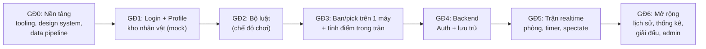
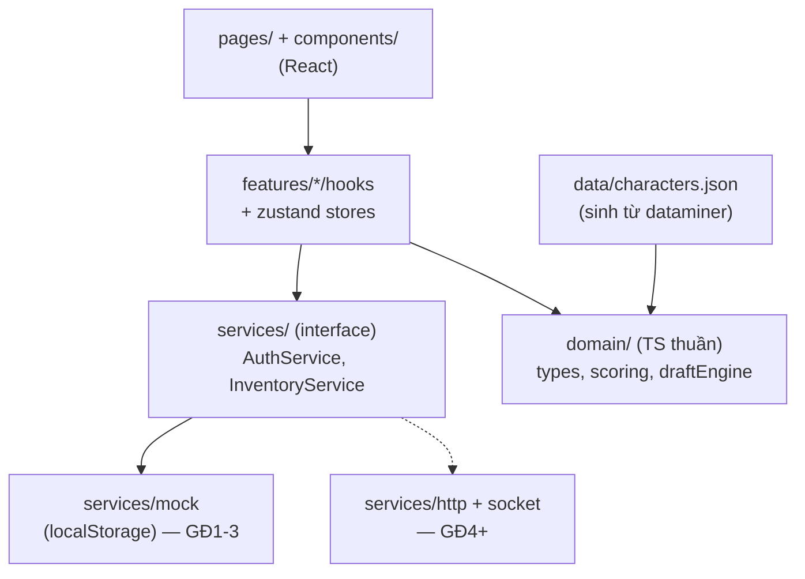

# Lộ trình phát triển — Genshin Ban/Pick VN

Tài liệu này theo dõi kế hoạch dài hạn cho nền tảng Ban/Pick nhân vật Genshin Impact (lưu kho tài khoản, chọn bộ luật/chế độ chơi, đấu ban/pick realtime, và tính điểm cân bằng trong trận).

## Tổng quan các giai đoạn

| GĐ | Trạng thái | Nội dung chính | Kết quả bàn giao |
|---|---|---|---|
| **0** | ✅ Hoàn thành | Cài router/Tailwind/zustand/vitest; design tokens; layout `AppShell`; nâng cấp dataminer xuất `characters.json` + ảnh slug hóa | App chạy, có khung điều hướng, dữ liệu 126 nhân vật có metadata |
| **1** | ✅ Hoàn thành | Trang Login/Register, Guest mode, Protected route; Profile: lưới nhân vật, bộ lọc, chỉnh sửa **Cung mệnh (C0–C6) + Level (90/95/100)**, thao tác hàng loạt, import/export JSON | Người dùng nhập & lưu kho trên trình duyệt qua mock services |
| **2** | ⏳ Kế hoạch | Mô hình `RuleSet` (thứ tự ban/pick, số ban/pick, timer, tham số điểm); trang **Bộ luật** xem/chọn preset | Chọn chế độ chơi |
| **3** | ⏳ Kế hoạch | `draftEngine` (state machine thuần TS) + **`scoring` chạy trong trận** (điểm theo cung mệnh/level của nhân vật được pick, chênh lệch → bù trừ); trang **Draft** 2 người trên 1 máy | Ban/pick đầy đủ không cần mạng *(chi tiết cơ chế điểm lập kế hoạch riêng trước GĐ3)* |
| **4** | ⏳ Kế hoạch | Backend: auth thật (email + Discord OAuth), REST API kho/bộ luật; thay `mock` service bằng `http` service | Dữ liệu đồng bộ giữa thiết bị |
| **5** | ⏳ Kế hoạch | Socket realtime: tạo phòng (mã mời), sẵn sàng, ban/pick có xác thực server, timer server, reconnect, khán giả/overlay OBS | Trận 1v1 online realtime |
| **6** | ⏳ Kế hoạch | Lịch sử trận, thống kê tỉ lệ ban/pick, trình chỉnh sửa bộ luật tùy biến & chia sẻ, giải đấu/bracket, i18n, import từ Enka.Network (UID) | Sản phẩm hoàn chỉnh |

## Bản đồ trang (đích cuối)

| Route | Trang | Giai đoạn |
|---|---|---|
| `/` | Trang chủ | 1 |
| `/login`, `/register` | Đăng nhập / đăng ký | 1 |
| `/profile` | Kho nhân vật của tôi | 1 |
| `/u/:username` | Xem kho người khác (chỉ đọc) | 4 |
| `/rules`, `/rules/:id` | Danh sách / chi tiết bộ luật | 2 |
| `/draft/local` | Ban/pick trên 1 máy | 3 |
| `/lobby`, `/match/:code` | Tạo/vào phòng, trận realtime | 5 |
| `/match/:code/overlay` | Overlay cho stream | 5 |
| `/history` | Lịch sử trận | 6 |

## Nguyên tắc kiến trúc frontend

- **Domain thuần TypeScript (`web/src/domain/`)**: không import React hoặc DOM. Ở GĐ4 sẽ tách thành package `packages/shared` để server dùng chung logic kiểm tra hợp lệ và tính điểm trong trận.
- **Lớp `services/` tách biệt giao diện với lưu trữ**: UI và store không gọi trực tiếp `localStorage`; mọi thao tác đi qua `AuthService` và `InventoryService` (`web/src/services/types.ts`). Khi chuyển sang backend thật chỉ cần thêm `services/http/` và đổi export trong `web/src/services/index.ts`.
- **Dữ liệu kho mỗi nhân vật**: chỉ lưu trạng thái sở hữu, cung mệnh (`0..6`), và level (`90 | 95 | 100`). Nhà Lữ Hành chỉ gồm 2 mục (`traveler-boy`, `traveler-girl`).
- **Tính điểm cân bằng**: không làm trang tính điểm độc lập; chỉ tồn tại bên trong trận ban/pick (lập kế hoạch chi tiết trước GĐ3).
